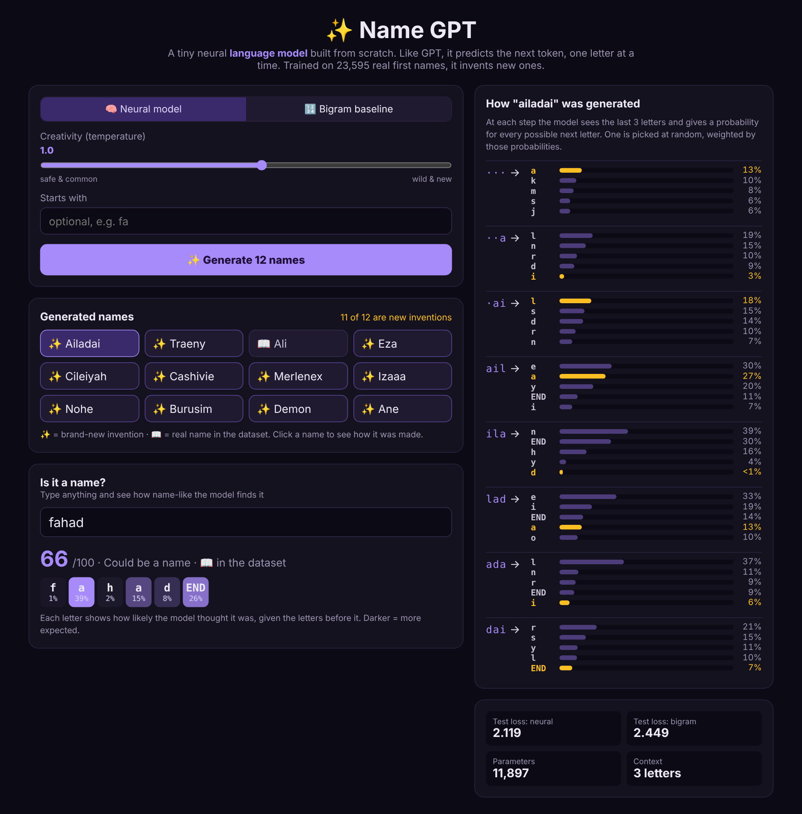
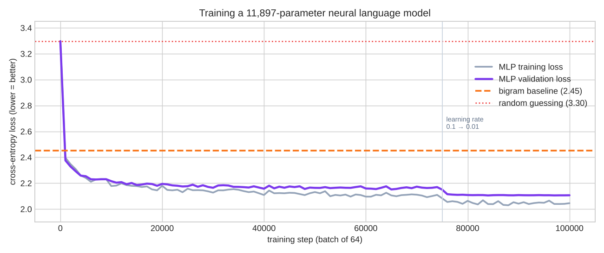
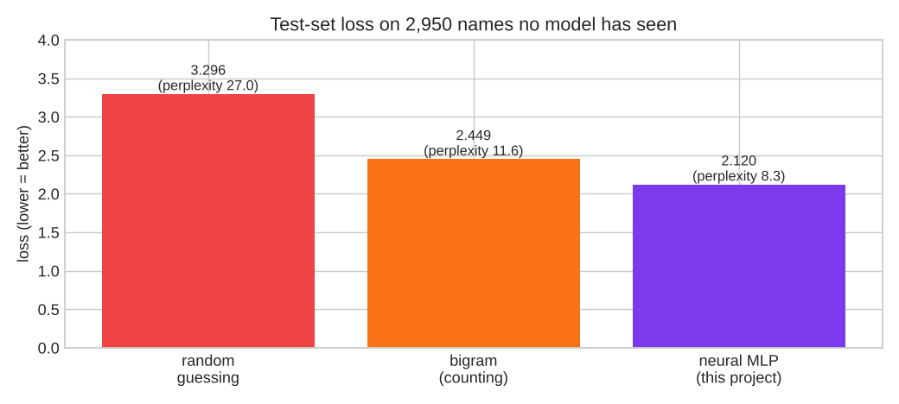
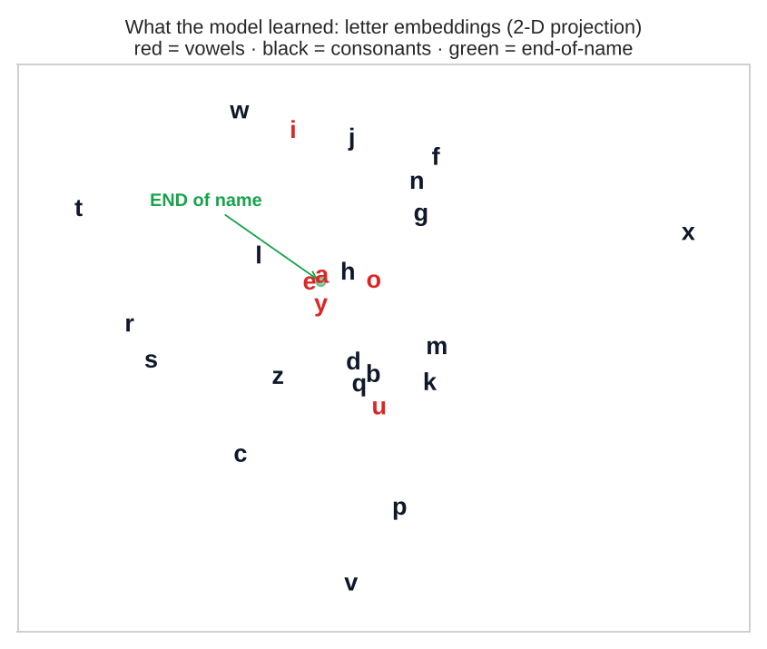

# ✨ Name GPT: A Tiny Neural Language Model from Scratch

A **character-level language model** built from scratch in NumPy (with hand-written backpropagation) that learns from 23,595 real first names, then **invents new ones**.
It works on the same principle as GPT: **predict the next token, one at a time**, then sample from those predictions. It's just tiny (11,897 parameters vs GPT-3's 175 billion) and uses letters instead of word pieces.



## Results

| Model | Test loss ↓ | Perplexity ↓ | Generated names that are real | Generated names that are new |
|---|---|---|---|---|
| Random guessing | 3.296 | 27.0 | – | – |
| Bigram (counting letter pairs) | 2.449 | 11.6 | 10% | 92% |
| **Neural MLP (this project)** | **2.120** | **8.3** | **23%** | **81%** |

*Test set: 2,950 names that neither model saw during training. Name rates are from 500 samples at temperature 1.0.*

**Perplexity** is how many letters the model is effectively "choosing between" at each step. The neural model narrows 27 possible characters down to about 8. It produces more than twice as many real names as the bigram, and most of its output is still brand new.

| Bigram samples | Neural model samples |
|---|---|
| morafr, srh, edelizliza, l, cjah, kesen, h | dayzlee, ilani, elle, kynn, zanille, roselynnell, nox |



The neural model passes the bigram baseline within the first ~1,000 steps. Dropping the learning rate at step 75,000 gives a final improvement. Training loss (2.045) stays close to validation loss (2.106), so the model learned general patterns rather than memorising names.





**What the model learned by itself:** each letter is represented as 10 numbers (an *embedding*), learned during training. Projected to 2-D, **a, e, y, o and the end-of-name marker** land together. Those are exactly the letters names tend to end with (emm**a**, jayd**e**, mill**y**), so the model treats them as similar. Nobody told it that.

## The app

Open `web/index.html` in your browser.

- **Generate 12 names** with the neural model or the bigram baseline, to compare them side by side
- **Creativity (temperature):** low gives safe, common names; high gives wild, new ones. (Measured: 60% real names at 0.5, 11% at 1.5)
- **Starts with:** force the first letters, e.g. `fa` → fardo, faleh, farhanvi, faizaben…
- ✨ marks brand-new inventions, 📖 marks real names in the dataset
- **How it was generated:** for each step, the 3 letters the model saw, its top-5 next-letter probabilities, and which letter was picked
- **Is it a name?** Type anything to see how expected each letter was (emma 94/100, fahad 66/100, xqzt 0/100)

## How it works

### 1. Data
32,033 names from [karpathy/makemore](https://github.com/karpathy/makemore) (MIT licence; originally from US Social Security records). **Deduplicated to 29,494** before splitting 80/10/10, so no name can appear in both training and test. Each name becomes training examples: `... → e`, `..e → m`, `.em → m`, `emm → a`, `mma → .` ('.' marks start/end).

### 2. The model ([Bengio et al., 2003](https://www.jmlr.org/papers/volume3/bengio03a/bengio03a.pdf))
```
last 3 letters → look up 10-number embedding for each (30 numbers)
              → hidden layer: 200 neurons, tanh
              → output: 27 scores → softmax → probability of each next letter
```

### 3. Training
- **Loss:** cross-entropy, the average of `−log P(correct next letter)`.
- **Backpropagation written by hand:** the gradient of the loss with respect to every weight, worked out with the chain rule. It's **verified against numerical gradients** (`training/gradcheck.py`, max relative error 1.3 × 10⁻⁷).
- **Mini-batch gradient descent:** 100,000 steps of 64 examples, learning rate 0.1, then 0.01. About 40 seconds on a laptop CPU.
- **Initialisation matters:** output weights start near zero, so the first guess is "every letter equally likely" (loss 3.30) instead of confidently wrong.

### 4. Generation (sampling)
Start with `...`, get the 27 probabilities, pick one at random weighted by probability, shift it into the context, and repeat until the model picks END. **Temperature** reshapes the probabilities first: `p^(1/T)`, renormalised.

### GPT vs this project
| | Name GPT | GPT models |
|---|---|---|
| Tokens | 27 characters | ~50,000–200,000 word pieces |
| Context | 3 tokens | thousands of tokens |
| Architecture | embeddings + MLP | embeddings + Transformer (attention) |
| Parameters | 11,897 | billions |
| Core idea | **predict the next token, sample, repeat** | **same** |

## Run it yourself

```bash
pip install -r requirements.txt
python training/gradcheck.py   # verify backprop
python training/train.py       # ~40 s: trains both models, saves charts, exports web/model.js
node web/test.js               # 6 tests
```

## Project structure

```
data/names.txt          # 32,033 names (from karpathy/makemore, MIT)
training/
  model.py              # bigram + MLP language model, hand-written backprop
  gradcheck.py          # numerical gradient check
  train.py              # training, evaluation, sampling, charts, export
  results.json          # losses, sample names, novelty rates
web/
  index.html, style.css, app.js   # generator, step-by-step view, name scorer
  lm.js                 # the same model + sampling in JavaScript
  model.js, names.js    # weights + dataset names (generated)
  test.js               # 6 tests incl. JS = Python probabilities
screenshots/
```

## Next steps
- Longer context (5–8 letters) and a bigger hidden layer
- Batch normalisation
- Replace the MLP with **self-attention**, a small Transformer, which is the step from this to GPT

## Credits
Dataset and inspiration: Andrej Karpathy's [makemore](https://github.com/karpathy/makemore) (MIT). All model and app code in this repo is original.

## License
MIT
